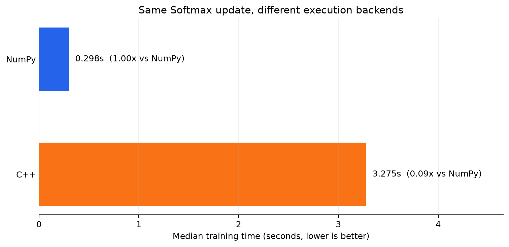
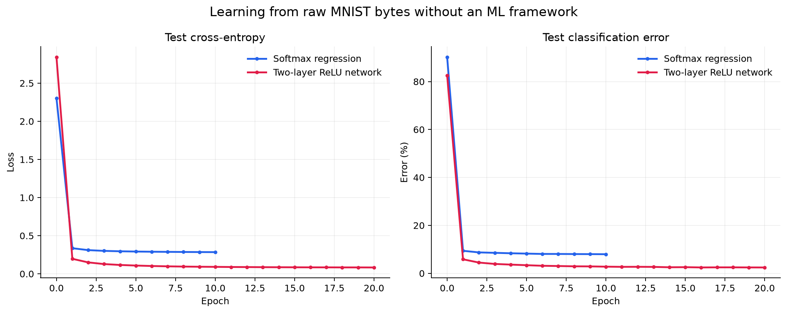
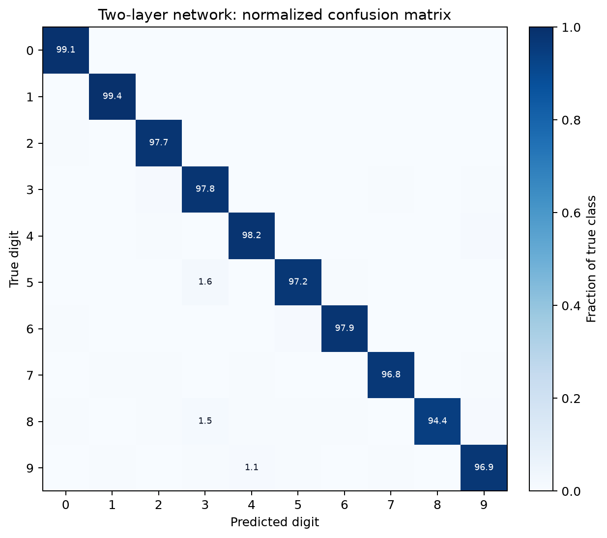
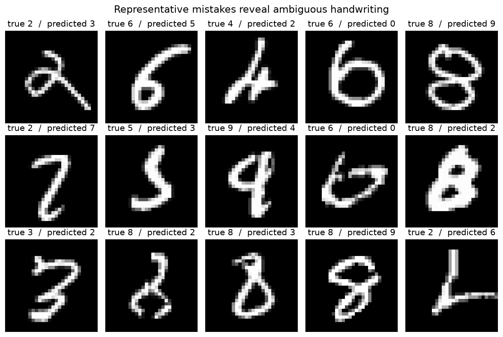
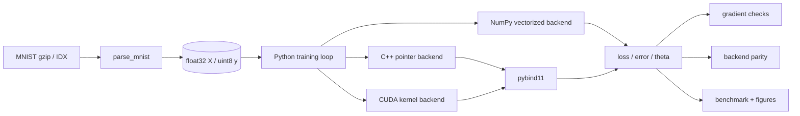

# From Math to Kernels: 无框架 MNIST 跨后端训练系统

> 从原始 IDX 字节、Softmax 交叉熵和手写反向传播，一直到 C++ 原生循环、CUDA kernel 和可复现性能实验。


本项目不使用 PyTorch、TensorFlow 或 Scikit-learn。目标不是再做一个 MNIST Demo，而是打通一条完整的机器学习系统链路：

- 解析 gzip 压缩的 MNIST IDX 二进制格式；
- 用 NumPy 向量化实现 Softmax 回归和两层 ReLU 网络；
- 手写数值稳定的交叉熵、反向传播和 mini-batch SGD；
- 用原生 C++ 和 CUDA 实现同一轮 Softmax 参数更新；
- 通过 pybind11 将原生后端接入统一 Python 训练入口；
- 通过数值梯度、后端参数差和统一 benchmark 验证正确性与性能。

## 结果摘要

完整 60,000 条训练集、10,000 条测试集：

| 模型 | 配置 | 测试错误率 |
|---|---|---:|
| Softmax 回归 | 10 epochs, batch 100, lr 0.2 | **7.97%** |
| 两层 ReLU 网络 | hidden 100, 20 epochs, batch 100, lr 0.2 | **2.44%** |

Apple Silicon、Python 3.14.7、NumPy 2.5.4 参考性能（完整训练集、10 epochs、batch 100、lr 0.2，3 次运行中位数）：

| 后端 | 训练耗时 | 相对 NumPy | 测试错误率 | 相对 NumPy 最大参数差 |
|---|---:|---:|---:|---:|
| NumPy | 0.298 s | 1.00x | 7.970% | 0 |
| 朴素 C++ | 3.276 s | 0.09x | 7.970% | 7.749e-7 |



**反直觉结论：**用 C++ 重写不等于自动加速。NumPy 的矩阵乘法已使用高度优化的底层数值库；朴素 C++ 循环缺少 SIMD、缓存分块和多核并行。系统性能取决于算法、访存与 kernel 实现，而不是语言标签。

## 可视化实验

`showcase.py` 从原始数据重新训练模型，产生收敛曲线、混淆矩阵、错分样本和机器可读的指标 JSON。



<p align="center">
  
</p>

<details>
<summary>展开查看典型错分样本</summary>



</details>

## 系统架构



数据解析、模型数学、训练调度、后端算子和评估工具相互独立。C++/CUDA 与 NumPy 共用同一数据和指标入口，使性能对比建立在相同计算任务上。

## 核心算法

对于 batch 输入 \(X\in\mathbb{R}^{B\times784}\) 和参数 \(\theta\in\mathbb{R}^{784\times10}\)：

\[
Z=X\theta,
\qquad
P=softmax(Z),
\qquad
\nabla_\theta L=\frac{X^T(P-Y_{one-hot})}{B}.
\]

两层网络执行：

\[
H=ReLU(XW_1),
\qquad
Z=HW_2,
\]

并通过链式法则手动计算 \(\nabla W_2\) 和 \(\nabla W_1\)。完整推导见 [算法与反向传播](docs/algorithm.md)。

## 三种执行后端

### NumPy

用矩阵乘法和广播完成向量化训练，Python 层不对样本和参数执行显式循环。

### C++ / pybind11

通过 C 连续 NumPy 内存的原始指针执行 row-major 索引，在 C++ 中原地更新 `theta`。该实现是正确性参考与性能分析基线，不声称击败 BLAS。

### CUDA

第一个 kernel 将样本映射到线程，计算 logits、稳定 Softmax 与 \(P-Y\)；第二个 kernel 将 `theta` 参数映射到线程，累加 batch 梯度并更新。无 NVIDIA GPU 时测试自动跳过。

详见 [性能实验与系统分析](docs/performance.md)。

## 快速开始

```bash
python3 -m venv .venv
source .venv/bin/activate
python -m pip install -r requirements.txt

make PYTHON=.venv/bin/python
python -m pytest -q
python src/simple_ml.py
```

### 重现可视化

```bash
make showcase PYTHON=.venv/bin/python
```

快速检查管线而不跑完整数据：

```bash
python showcase.py \
  --train-samples 10000 --test-samples 2000 \
  --softmax-epochs 3 --network-epochs 5 \
  --output /tmp/mnist-showcase
```

### 统一后端 benchmark

```bash
python benchmark.py --samples 10000 --epochs 3 --repeats 3 \
  --json assets/showcase/backend_benchmark.json \
  --plot assets/showcase/backend_benchmark.png
```

### CUDA

CUDA 需要 Linux、NVIDIA GPU、CUDA Toolkit 和 `nvcc`：

```bash
make cuda PYTHON=.venv/bin/python
python -m pytest -q -k cuda
```

Apple Silicon 无法直接执行 NVIDIA CUDA。本项目不使用未运行的 GPU 数字进行性能宣传。

## 工程结构

```text
.
├── src/
│   ├── simple_ml.py          # 数据、损失、NumPy 模型与训练
│   ├── simple_ml_ext.cpp     # 朴素 C++ 训练后端
│   └── simple_ml_cuda.cu     # CUDA kernels 与显存管理
├── tests/                     # 数据、梯度、后端一致性测试
├── docs/
│   ├── algorithm.md           # 数学推导与矩阵形状
│   ├── performance.md         # CPU/GPU 性能分析
│   └── interview.md           # 五分钟演示与随机追问
├── showcase.py               # 重训模型并生成展示图表
├── benchmark.py              # 后端耗时、精度与参数差
└── Makefile                  # C++/CUDA 编译与快捷命令
```

## 测试策略

- MNIST magic number、头部长度、数据长度、dtype 和形状检查；
- 用有限差分检查 Softmax 与两层网络的分析梯度；
- 检查完整 epoch 后的参数范数和损失/错误率；
- 将 C++/CUDA 的更新参数与 NumPy 参考实现对齐；
- 无 CUDA 扩展或可用 GPU 时，CUDA 测试显式标记为 skip。

## 已知边界与路线图

- 两层网络按题目要求未加偏置项；
- C++ 后端是朴素基线，可进一步加入 SIMD、缓存分块、OpenMP 或 BLAS；
- CUDA 后端可进一步进行 kernel 融合、共享内存优化与 cuBLAS 对照；
- 性能报告应补充 NVIDIA 设备名称、工具链版本与预热后的 GPU 实测。

## 答辩准备

项目的 [五分钟演示脚本与随机追问](docs/interview.md) 覆盖矩阵形状、数值稳定、反向传播、pybind11、CUDA 线程映射、性能反直觉以及项目边界。
